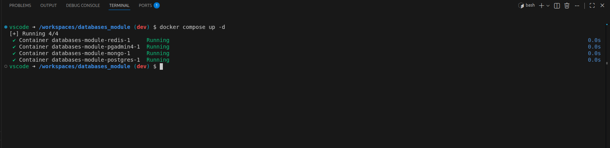

#### 1. A screenshot of docker compose ps with the three engines healthy.
 

#### 2. The data model of your database: list of tables and relationships. ###

    CREATE TABLE IF NOT EXISTS hello (
        id         integer GENERATED ALWAYS AS IDENTITY PRIMARY KEY,
        msg        text NOT NULL,
        created_at timestamptz NOT NULL DEFAULT now())

#### 3. Three concrete problems in that model (for example duplicated data, a missing constraint, a field that should be a table, a price calculated on read), with the file and line where each one is. ####

1. Linha 3 (msg): aceita texto vazio ('') e sem limite de tamanho. Porque NOT NULL só bloqueia NULL, não bloqueia vazio. Falta um CHECK.

2. Linha 2-4 (tabela toda): não guarda quem escreveu a mensagem. Porque sem author_id não sabes quem enviou cada uma, e acrescentar isto mais tarde, com dados já inseridos, dá mais trabalho.

3. Linha 4 (created_at): não tem índice. Porque quando pedires “as últimas mensagens” a base de dados lê a tabela toda, e fica lenta à medida que cresce.

#### 4. What would happen with 100,000 records, or with two users writing at the same time.

100.000 registos: inserir continua rápido, mas ler “as últimas mensagens” sem índice em created_at faz o PostgreSQL ler e ordenar tudo, e piora a cada registo novo.

Dois utilizadores ao mesmo tempo: os ids não colidem e não há bloqueios, mas duas mensagens podem ficar com a mesma hora (now()) e não há nada que impeça duplicados.

#### 5. Would any of the data be better in MongoDB or Redis? Why? ####

Não, o PostgreSQL chega.

MongoDB: só compensava se as mensagens tivessem campos muito diferentes entre si. Aqui a estrutura é fixa e, com o author_id, vais precisar de JOINs, onde o PostgreSQL é mais forte.

Redis: não serve como base de dados principal, porque guarda os dados em memória e há mais risco de os perder. Mas é útil como cache das “últimas mensagens” ou para limitar o número de mensagens por minuto.
