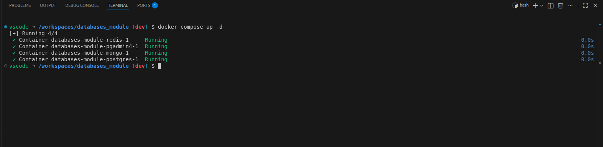

# Exercício 01: Diagnóstico de `shop.json`

## Ficheiros

| Ficheiro | Conteúdo |
|----------|----------|
| `README.md` | Este ficheiro: captura de ecrã e respostas às tarefas 2 a 5 |
| `shop.json` | Os dados da loja, exatamente como no enunciado (os números de linha abaixo referem-se a este ficheiro) |
| `docker-compose-ps.png` | Captura de ecrã de `docker compose ps` |

Para ver o ficheiro com números de linha, a partir da raiz do repositório:

```bash
cat -n exercises/01-diagnosis/exercise/shop.json
```

## 1. `docker compose ps`

```bash
docker compose up -d
docker compose ps
```



## 2. Modelo de dados

O ficheiro tem três entidades, cada uma guardada numa lista:

| Entidade | Campos | Linhas |
|----------|--------|--------|
| `customers` | `id`, `name`, `email`, `city` | 2 a 5 |
| `orders` | `id`, `customer_id`, `customer_name`, `customer_email`, `items`, `total`, `date` | 6 a 13 |
| `products` | `name`, `price`, `stock` | 14 a 17 |

Relações:

- **customers 1 : N orders.** Cada encomenda aponta para um cliente através de `customer_id`. Também guarda uma cópia do nome e do email do cliente.
- **orders N : M products.** Uma encomenda tem vários produtos e um produto aparece em várias encomendas. Esta relação não está modelada: está escondida dentro do texto de `items` (`"Keyboard x1; Mouse x2"`) e liga-se aos produtos pelo nome, porque os produtos não têm `id`.

Nada no ficheiro obriga a que estas relações sejam respeitadas. São apenas uma convenção que a aplicação tem de cumprir sozinha.

## 3. Problemas encontrados

| # | Linha(s) | Tipo de problema | O que está mal | O que pode correr mal |
|---|----------|------------------|----------------|------------------------|
| 1 | 7, 9, 11 | Dados duplicados | `customer_name` e `customer_email` são copiados do cliente para cada encomenda | As cópias deixam de coincidir. Na linha 11 a Ana tem o email `ana.silva@example.com`, mas na linha 3 tem `ana@example.com`. Não se sabe qual está certo. |
| 2 | 9 | Falta de integridade referencial (chave estrangeira) | `customer_id: 3` aponta para um cliente que não existe (só há os ids 1 e 2) | Encomenda órfã: não é possível saber a morada nem o cliente verdadeiro, e os relatórios por cliente ficam errados |
| 3 | 9, 11 | Falta de chave primária / unicidade | Duas encomendas têm `id: 2` | Pedir "a encomenda 2" devolve duas, e uma atualização ou um cancelamento pode afetar a encomenda errada |
| 4 | 8, 10, 12 | Lista guardada num único campo | `items` é um texto como `"Keyboard x1; Mouse x2"` | Não se consegue somar quantidades nem procurar "todas as encomendas com Mouse" sem fazer parsing de texto. Basta um erro de escrita (por exemplo `Mouse  x 2`) para o parsing falhar. Também não fica guardado o preço de cada produto na altura da compra. |
| 5 | 8, 10, 11 | Tipo errado / inconsistente | `total` é texto `"59.90"` na linha 8, texto inválido `"abc"` na linha 10 e número `12.5` na linha 11 | Somar a faturação dá erro ou concatena texto, e `"abc"` não é um valor monetário |
| 6 | 12 | Falta de regra de integridade (CHECK) | Quantidade negativa: `"Mouse x-1"` | Uma encomenda com quantidade negativa pode aumentar o stock ou dar um total errado. Para além disso, `12.5` não bate certo com o preço do rato (`-1 × 15`). |
| 7 | 16 | Falta de regra de integridade (CHECK) | `stock: -2` | Vendeu-se mais do que havia em armazém, e nada impediu isso |
| 8 | 8, 10, 12 | Formato inconsistente | As datas aparecem como `"07/10/2026"` (linhas 8 e 12) e `"2026-10-08"` (linha 10) | Ordenar por data como texto dá a ordem errada. `07/10/2026` pode ser 7 de outubro ou 10 de julho, consoante o país. |
| 9 | 16 | Tipo errado | `price: "15"` é texto, mas na linha 15 o preço é um número | `29.90 + "15"` dá erro ou o texto `"29.915"`, consoante a linguagem |
| 10 | 15, 16 | Falta de chave primária | Os produtos não têm `id` e as encomendas referem-nos pelo nome | Mudar o nome de um produto parte a ligação com as encomendas antigas, e dois produtos com o mesmo nome não se distinguem |
| 11 | 9 | Falta de validação de formato | `customer_email: "marta@example"` não é um email válido (falta o domínio) | Emails de confirmação ou de faturação nunca chegam ao cliente |

Os problemas identificados são de 7 tipos diferentes: dados duplicados, chave estrangeira em falta, chave primária em falta, lista num único campo, tipo errado, regra de integridade em falta e formato inconsistente.

## 4. Com 100 000 encomendas e com dois pedidos ao mesmo tempo

**Encontrar as encomendas de um cliente.** Não há índice. A aplicação tem de ler o ficheiro inteiro (dezenas de MB), fazer o parsing de todo o JSON para memória e percorrer as 100 000 encomendas uma a uma. Isto acontece em cada pedido, mesmo que o cliente tenha só 3 encomendas. O tempo e a memória crescem com o tamanho total do ficheiro, não com o tamanho da resposta.

**Adicionar uma encomenda.** Para acrescentar um registo de ~200 bytes, a aplicação lê o ficheiro inteiro, faz o parsing, acrescenta a encomenda e volta a escrever o ficheiro todo. Cada encomenda nova fica mais lenta do que a anterior. Para gerar o `id` também tem de percorrer todas as encomendas (máximo + 1). Se o processo falhar a meio da escrita (falta de luz, crash), o ficheiro fica truncado e é JSON inválido: perdem-se **todos** os dados, não só a última encomenda.

**Dois pedidos a adicionar uma encomenda ao mesmo tempo.** Os dois leem a mesma versão do ficheiro, cada um acrescenta a sua encomenda em memória e os dois escrevem o ficheiro inteiro. A segunda escrita apaga a primeira: uma das encomendas perde-se sem nenhum erro (*lost update*). Os dois podem também calcular o mesmo `id` (máximo + 1), que é exatamente o que se vê nas linhas 9 e 11 com o `id: 2` duplicado. Um terceiro pedido que leia o ficheiro enquanto ele está a ser escrito encontra JSON incompleto e falha. O desafio desta sessão mede este efeito com números.

Uma base de dados resolve estes problemas com índices (procurar sem ler tudo), escritas de uma linha só (não reescreve a tabela inteira), transações (tudo ou nada, mesmo com crash) e controlo de concorrência (duas inserções ao mesmo tempo ficam as duas guardadas).

## 5. Que motor usar para cada tipo de dados

| Dados | Motor | Porquê |
|-------|-------|--------|
| Clientes | **PostgreSQL** | Dados do domínio que não se podem perder nem contradizer. Precisam de chave primária, de email único e válido (`UNIQUE`, `CHECK`), e são referidos pelas encomendas através de chave estrangeira. |
| Encomendas | **PostgreSQL** | São dinheiro: precisam de transações ACID. Criar uma encomenda, criar as suas linhas (`order_items`) e baixar o stock tem de acontecer tudo ou nada. As chaves estrangeiras impedem encomendas de clientes ou produtos que não existem, e os `CHECK` impedem quantidades e totais negativos. |
| Produtos | **PostgreSQL** | O stock é alterado na mesma transação que a encomenda, e um `CHECK (stock >= 0)` impede vender o que não existe. Só valeria a pena usar MongoDB se o catálogo tivesse atributos muito diferentes de produto para produto (um teclado tem layout, um monitor tem polegadas). Mesmo assim, preço e stock ficariam no PostgreSQL. |
| Últimos 10 produtos vistos por um cliente | **Redis** | Muda a cada clique, pode perder-se sem prejuízo e pode expirar. Uma lista por cliente com `LPUSH` + `LTRIM 0 9` mantém exatamente os 10 últimos, em memória, e o `EXPIRE` apaga-a se o cliente não voltar. |
| Número de aberturas de cada página de produto hoje | **Redis** | É um contador incrementado muitas vezes por segundo. `INCR` (ou `HINCRBY`) é atómico e não perde incrementos com pedidos simultâneos, e uma chave por dia com `EXPIRE` limpa-se sozinha. Escrever uma linha no PostgreSQL por cada visita seria desnecessariamente pesado. Se o total for preciso para histórico, copia-se para o PostgreSQL uma vez por dia. |
