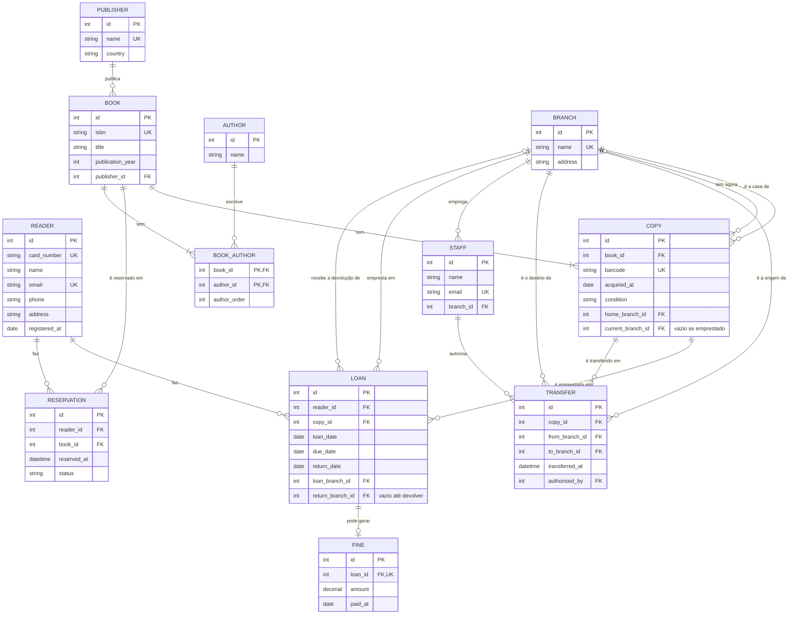

# Desafio: três filiais e histórico de transferências

## Enunciado

**Challenge (mandatory).**

**Goal.** Extend a model with history and check it against a stricter normal form.

**Starting point.** The requirements of the exercise above. You can start from your own model.

**Tasks.**

1. The library opens three branches. Each copy belongs to one home branch, can be transferred to another branch, and can be returned at any branch. Extend the model so that it records where each copy is at any moment and the full history of its transfers (from, to, date and who authorised it).
2. Write two queries in plain language that the new model must answer, for example "where is copy X now?" and "which copies left branch Y last month?", and show which tables answer each one.
3. Find a table in your model that is in 3NF but not in BCNF (Boyce-Codd normal form), or show that none exists. Explain the difference between the two forms with an example.

**Deliverables.** `model.md` with the extended Mermaid diagram, the new and changed tables, and the answers to tasks 2 and 3.

**Done when.** The current location of a copy can be found without reading its whole history (or the README explains why reading the history is acceptable), every transfer is kept, and the BCNF answer includes the functional dependencies that justify it.

---

# 1. Modelo estendido

**Task 1.** The library opens three branches. Each copy belongs to one home branch, can be transferred to another branch, and can be returned at any branch. Extend the model so that it records where each copy is at any moment and the full history of its transfers (from, to, date and who authorised it).

## O que muda, em resumo

- Três tabelas novas: `BRANCH` (filiais), `STAFF` (funcionários, para saber quem autoriza) e `TRANSFER` (uma linha por transferência, nunca se apaga).
- `COPY` ganha a filial de origem (`home_branch_id`) e a filial onde está agora (`current_branch_id`).
- `LOAN` ganha a filial onde foi feito o empréstimo (`loan_branch_id`) e a filial onde foi devolvido (`return_branch_id`).

## Diagrama ER

## Tabelas novas

### BRANCH
- Colunas: id, name, address
- Chave primária: id
- Únicas: name

### STAFF
- Colunas: id, name, email, branch_id
- Chave primária: id
- Chave estrangeira: branch_id → BRANCH(id)
- Únicas: email

### TRANSFER
- Colunas: id, copy_id, from_branch_id, to_branch_id, transferred_at, authorised_by
- Chave primária: id
- Chaves estrangeiras: copy_id → COPY(id), from_branch_id → BRANCH(id), to_branch_id → BRANCH(id), authorised_by → STAFF(id)
- Únicas: (copy_id, transferred_at), porque a mesma cópia não é transferida duas vezes no mesmo instante
- Todas as colunas são obrigatórias. Nunca se altera nem se apaga uma linha: é o histórico.

## Tabelas alteradas

### COPY (colunas novas)
- `home_branch_id`: chave estrangeira → BRANCH(id), obrigatória. É a filial a que a cópia pertence e nunca muda.
- `current_branch_id`: chave estrangeira → BRANCH(id). É a filial onde a cópia está agora. Fica **vazia enquanto a cópia está emprestada**. Quando a cópia entra no sistema, é igual a `home_branch_id`.

### LOAN (colunas novas)
- `loan_branch_id`: chave estrangeira → BRANCH(id), obrigatória. Filial onde o empréstimo foi feito.
- `return_branch_id`: chave estrangeira → BRANCH(id). Filial onde a cópia foi devolvida. Fica vazia até devolver, tal como `return_date`.

As restantes tabelas (`READER`, `PUBLISHER`, `AUTHOR`, `BOOK`, `BOOK_AUTHOR`, `RESERVATION`, `FINE`) ficam como estavam.

## Como se sabe onde está uma cópia

A localização atual está em `COPY.current_branch_id`. Não é preciso ler o histórico: é uma consulta a uma só linha.

Esta coluna repete informação que também se pode deduzir de `TRANSFER` e `LOAN`, e é uma desnormalização de propósito. O histórico (`TRANSFER` e `LOAN`) é a fonte de verdade e a coluna é só um atalho, mantido por trigger na mesma transação (ver as regras abaixo). Assim, a pergunta mais frequente ("onde está esta cópia?") é rápida e nenhuma transferência se perde.

## Regras novas

| Regra | Onde aplicar | Como |
|---|---|---|
| Uma transferência tem de ser entre filiais diferentes | Constraint | `CHECK (from_branch_id <> to_branch_id)` |
| `return_branch_id` está vazio se e só se `return_date` está vazio | Constraint | `CHECK ((return_date IS NULL) = (return_branch_id IS NULL))` |
| A origem da transferência é a filial onde a cópia está agora | Trigger | `BEFORE INSERT` em `TRANSFER`: `from_branch_id` tem de ser igual a `COPY.current_branch_id` |
| Não se transfere uma cópia que está emprestada | Trigger | O mesmo trigger recusa se `COPY.current_branch_id` estiver vazio |
| Depois de uma transferência, a cópia fica no destino | Trigger | `AFTER INSERT` em `TRANSFER`: `COPY.current_branch_id = to_branch_id` |
| Um empréstimo só se faz na filial onde a cópia está | Trigger | `BEFORE INSERT` em `LOAN`: `loan_branch_id` = `COPY.current_branch_id`; depois fica `current_branch_id` vazio |
| Ao devolver, a cópia fica na filial da devolução | Trigger | Quando `return_date` passa a ter valor: `COPY.current_branch_id = return_branch_id` |

## Pressupostos

- Uma transferência é instantânea, não há estado "em trânsito". Se fosse preciso, acrescentava-se `received_at` a `TRANSFER`.
- Devolver numa filial diferente **não** cria uma transferência. Fica registado em `LOAN.return_branch_id` e a cópia passa a estar nessa filial. Uma transferência é sempre uma mudança de filial ordenada por um funcionário.
- "Uma cópia saiu da filial Y" quer dizer que foi transferida de Y para outra filial. Se também se quisesse contar os empréstimos, juntava-se `LOAN.loan_branch_id`.

---

# 2. Duas perguntas que o modelo tem de responder

**Task 2.** Write two queries in plain language that the new model must answer, for example "where is copy X now?" and "which copies left branch Y last month?", and show which tables answer each one.

## Pergunta A: "Onde está a cópia X agora?"

- Vê-se a filial em `COPY.current_branch_id` e vai-se buscar o nome a `BRANCH`.
- Se `current_branch_id` estiver vazio, a cópia está emprestada: o empréstimo aberto (`return_date` vazio) em `LOAN` diz a que leitor, que se vê em `READER`.
- **Tabelas:** `COPY` e `BRANCH`; se estiver emprestada, também `LOAN` e `READER`.
- Não lê o histórico: é uma linha de `COPY`.

## Pergunta B: "Que cópias saíram da filial Y no mês passado?"

- Procura-se em `TRANSFER` as linhas com `from_branch_id` = Y e `transferred_at` dentro do mês passado.
- Para mostrar o livro, liga-se `COPY` (pelo `copy_id`) e depois `BOOK`; para mostrar o destino, `BRANCH` outra vez (pelo `to_branch_id`).
- **Tabelas:** `TRANSFER`, `COPY`, `BOOK` e `BRANCH`.
- Convém um índice em `TRANSFER (from_branch_id, transferred_at)`.

## Extra: "Onde estava a cópia X no dia D?"

Esta já precisa do histórico: olha-se para as linhas de `TRANSFER` dessa cópia até ao dia D (a última dá a filial), e para `LOAN` para saber se estava emprestada ou devolvida noutra filial. É por isso que o histórico não se apaga.

---

# 3. BCNF

**Task 3.** Find a table in your model that is in 3NF but not in BCNF (Boyce-Codd normal form), or show that none exists. Explain the difference between the two forms with an example.

## A diferença entre 3NF e BCNF

Uma dependência funcional `X → A` quer dizer que o valor de X decide o valor de A.

- **3NF:** para cada dependência `X → A`, ou X é uma chave (superchave), ou A faz parte de alguma chave candidata.
- **BCNF:** para cada dependência `X → A`, X **tem** de ser uma chave. Não há exceção.

A BCNF é mais exigente: toda a tabela em BCNF está em 3NF, mas não ao contrário. A diferença só aparece quando uma tabela tem chaves candidatas que se sobrepõem.

### Exemplo (que não está no meu modelo)

Imagina que a biblioteca guardava em que prateleira está cada livro em cada filial:

`BOOK_SHELF(branch_id, book_id, shelf)`

Regras: num filial, um livro está numa só prateleira, e o código da prateleira é único em toda a biblioteca (por exemplo `L1-A` é sempre da filial L1).

| branch_id | book_id | shelf |
|---|---|---|
| L1 | 10 | L1-A |
| L1 | 11 | L1-A |
| L2 | 10 | L2-C |

Dependências funcionais:

- `(branch_id, book_id) → shelf`
- `shelf → branch_id`

Chaves candidatas: `(branch_id, book_id)` e `(shelf, book_id)`.

- Está em **3NF**: em `shelf → branch_id`, `shelf` não é chave, mas `branch_id` faz parte de uma chave candidata, e isso chega para a 3NF.
- **Não** está em **BCNF**: `shelf` é um determinante que não é chave.

O problema na prática: a filial de cada prateleira repete-se em todas as linhas dessa prateleira. Se a prateleira mudasse de filial, era preciso alterar muitas linhas, e uma prateleira vazia não podia ser registada com a sua filial.

A correção é separar: `SHELF(shelf, branch_id)` e `BOOK_SHELF(book_id, shelf)`. Mas perde-se a regra "um livro está numa só prateleira por filial", que deixa de poder ser garantida por uma chave e passa a precisar de um trigger. É por isso que muitas vezes se aceita 3NF.

## Verificação das tabelas do meu modelo

Para cada tabela, as dependências funcionais e as chaves candidatas:

| Tabela | Dependências funcionais | Chaves candidatas | BCNF? |
|---|---|---|---|
| `READER` | id → tudo; card_number → tudo; email → tudo | id, card_number, email | Sim |
| `PUBLISHER` | id → name, country; name → id, country | id, name | Sim |
| `AUTHOR` | id → name | id | Sim |
| `BOOK` | id → tudo; isbn → tudo | id, isbn | Sim |
| `BOOK_AUTHOR` | (book_id, author_id) → author_order; (book_id, author_order) → author_id | (book_id, author_id), (book_id, author_order) | Sim |
| `BRANCH` | id → name, address; name → id, address | id, name | Sim |
| `STAFF` | id → tudo; email → tudo | id, email | Sim |
| `COPY` | id → tudo; barcode → tudo | id, barcode | Sim |
| `TRANSFER` | id → tudo; (copy_id, transferred_at) → tudo | id, (copy_id, transferred_at) | Sim |
| `RESERVATION` | id → tudo | id | Sim |
| `FINE` | id → tudo; loan_id → tudo | id, loan_id | Sim |
| `LOAN` | id → tudo; **loan_date → due_date** | id | **Não** (ver abaixo) |

Em todas as tabelas menos uma, todo o lado esquerdo de uma dependência é uma chave candidata, por isso estão em BCNF (e portanto em 3NF).

`BOOK_AUTHOR` é a mais interessante: tem duas chaves candidatas que se sobrepõem (`book_id` aparece nas duas), que é o cenário onde a BCNF podia falhar. Mas as duas dependências têm uma chave à esquerda, por isso passa.

### O caso de `LOAN`

Com a regra "o prazo é 14 dias depois do empréstimo", `loan_date → due_date`. `loan_date` não é chave e `due_date` não faz parte de nenhuma chave. Isto quebra a **3NF** (e por isso também a BCNF), e é pior do que o caso pedido.

Mantive `due_date` porque o enunciado diz que o empréstimo a regista, e assim fica guardado o prazo certo se a política mudar. É uma desnormalização assumida, protegida por `CHECK (due_date = loan_date + 14)`. Para ficar em 3NF estrita, bastava tirar a coluna e calcular `loan_date + 14` quando fosse preciso.

### Resposta

Não existe nenhuma tabela no meu modelo que esteja em 3NF mas não em BCNF. Todas estão em BCNF, exceto `LOAN`, que nem chega à 3NF por causa de `due_date`, e isso é uma escolha deliberada.

A coluna nova `COPY.current_branch_id` não conta aqui: repete informação que está noutras tabelas (`TRANSFER`, `LOAN`), mas não depende de outra coluna da própria `COPY`, por isso não cria nenhuma dependência funcional nova na tabela.