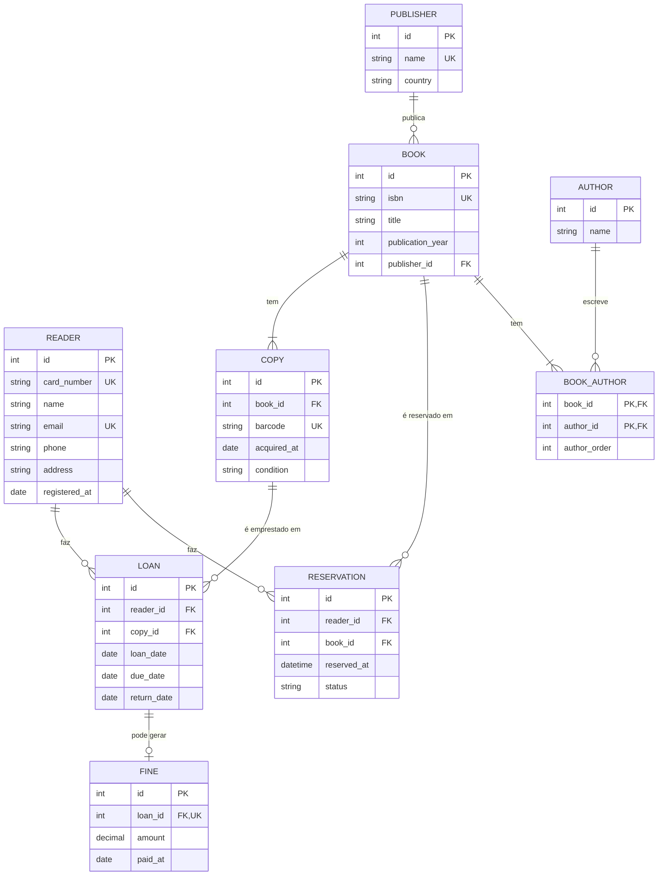

# Modelo da biblioteca municipal

## Enunciado

**Goal.** Turn written requirements into an ER diagram and a set of tables in 3NF.

**Requirements of a municipal library:**

* A reader has a unique card number, a name, a unique email, a phone number, an address and a registration date.
* A book has a unique ISBN-13, a title, a publication year, exactly one publisher and one or more authors. An author can write many books. For each book, the order of its authors matters (first author, second author, ...).
* A publisher has a unique name and a country.
* The library owns one or more copies of each book. A copy has a unique barcode, an acquisition date and a condition: `new`, `good`, `worn` or `damaged`.
* A reader borrows a copy. A loan records the reader, the copy, the loan date, the due date (14 days after the loan date) and the return date, which stays empty until the copy is returned. A copy can be in at most one open loan at a time. A reader can have at most 5 open loans.
* A reader can reserve a book (not a specific copy) when no copy of it is available. Reservations for the same book are served in the order they were made. A reservation is `active`, `fulfilled` or `cancelled`.
* A late return creates a fine of 0.50 per day late. A fine belongs to exactly one loan and records its amount and the date it was paid, which stays empty until it is paid.

**Tasks.**

1. Draw an ER diagram in Mermaid (`erDiagram`, as in the tutorial) with every entity, its attributes, primary keys, foreign keys and the cardinality of every relationship.
2. List the tables in 3NF. For each table give its columns, its primary key, its foreign keys and its `UNIQUE` columns.
3. List the business rules from the requirements that a table structure alone cannot enforce (for example "at most 5 open loans") and say where you would enforce each one: a constraint, a trigger or the application.
4. Describe one denormalisation you would make and why, or explain why you would make none.

**Deliverables.** `model.md` with the diagram and the answers to tasks 2 to 4. Check on GitHub that the diagram renders.

**Done when.** Every requirement above appears in the model, the N:N relationship between books and authors has an association table that keeps the author order, the tables are in 3NF, and the diagram renders on GitHub.

---

# 1. Diagrama ER

**Task 1.** Draw an ER diagram in Mermaid (`erDiagram`, as in the tutorial) with every entity, its attributes, primary keys, foreign keys and the cardinality of every relationship.

## Como ler as relações

| Relação | Tipo | Em palavras |
|---|---|---|
| Reader — Loan | 1:N | Um leitor faz vários empréstimos; cada empréstimo é de um leitor |
| Reader — Reservation | 1:N | Um leitor faz várias reservas; cada reserva é de um leitor |
| Book — Copy | 1:N | Um livro tem um ou mais exemplares; cada exemplar é de um livro |
| Copy — Loan | 1:N | Um exemplar é emprestado muitas vezes, uma de cada vez |
| Book — Reservation | 1:N | Um livro pode ter várias reservas |
| Publisher — Book | 1:N | Uma editora publica vários livros; cada livro tem uma só editora |
| Book — Author | N:N | Um livro tem um ou mais autores e um autor escreve vários livros. Por isso há a tabela `BOOK_AUTHOR`, que também guarda a ordem dos autores |
| Loan — Fine | 1:0..1 | Um empréstimo tem no máximo uma multa |

## Decisões

- A reserva é de um **livro**, não de uma cópia concreta.
- O empréstimo é de uma **cópia**, que é o objeto físico.
- "Empréstimo aberto" quer dizer `return_date` vazio.
- As reservas de um livro servem-se por ordem de `reserved_at`.

---

# 2. Tabelas em 3NF

**Task 2.** List the tables in 3NF. For each table give its columns, its primary key, its foreign keys and its `UNIQUE` columns.

Todas as colunas são obrigatórias, exceto `return_date` (até devolver) e `paid_at` (até pagar).

## READER
- Colunas: id, card_number, name, email, phone, address, registered_at
- Chave primária: id
- Únicas: card_number, email

## PUBLISHER
- Colunas: id, name, country
- Chave primária: id
- Únicas: name

## AUTHOR
- Colunas: id, name
- Chave primária: id

## BOOK
- Colunas: id, isbn, title, publication_year, publisher_id
- Chave primária: id
- Chave estrangeira: publisher_id → PUBLISHER(id)
- Únicas: isbn

## BOOK_AUTHOR
- Colunas: book_id, author_id, author_order
- Chave primária: (book_id, author_id)
- Chaves estrangeiras: book_id → BOOK(id), author_id → AUTHOR(id)
- Únicas: (book_id, author_order), para não haver dois autores na mesma posição

## COPY
- Colunas: id, book_id, barcode, acquired_at, condition
- Chave primária: id
- Chave estrangeira: book_id → BOOK(id)
- Únicas: barcode
- `condition` só aceita: new, good, worn, damaged

## LOAN
- Colunas: id, reader_id, copy_id, loan_date, due_date, return_date
- Chave primária: id
- Chaves estrangeiras: reader_id → READER(id), copy_id → COPY(id)

## RESERVATION
- Colunas: id, reader_id, book_id, reserved_at, status
- Chave primária: id
- Chaves estrangeiras: reader_id → READER(id), book_id → BOOK(id)
- `status` só aceita: active, fulfilled, cancelled

## FINE
- Colunas: id, loan_id, amount, paid_at
- Chave primária: id
- Chave estrangeira: loan_id → LOAN(id)
- Únicas: loan_id, para ser no máximo uma multa por empréstimo

## O que é cada forma normal

- **1NF:** cada coluna guarda um só valor (nada de listas dentro de uma célula) e não há colunas repetidas.
- **2NF:** está em 1NF e, nas tabelas com chave composta, cada coluna depende da chave inteira e não só de uma parte dela.
- **3NF:** está em 2NF e nenhuma coluna depende de outra coluna que não seja a chave (sem dependências indiretas).

## Porque é que as tabelas estão em 3NF

- **1NF:** os autores de um livro não estão numa lista dentro de `BOOK`; cada autor é uma linha em `BOOK_AUTHOR`.
- **2NF:** a única chave composta é `BOOK_AUTHOR`, e `author_order` depende do par livro + autor, não de um deles sozinho.
- **3NF:** a editora e os autores têm tabelas próprias, em vez de repetir o nome e o país em cada livro. Assim nenhuma coluna depende de outra que não seja a chave.
- **Exceção assumida, `LOAN.due_date`:** como o prazo é sempre 14 dias, `loan_date → due_date`, o que em rigor quebra a 3NF. Mantenho a coluna porque o enunciado diz que o empréstimo regista o prazo, e porque assim o prazo de empréstimos antigos não muda se a regra dos 14 dias mudar. A regra fica protegida por `CHECK (due_date = loan_date + 14)`, por isso as duas colunas nunca se contradizem. Para 3NF estrita, tirava-se a coluna e calculava-se `loan_date + 14`. (Ver também o desafio, tarefa 3.)

---

# 3. Regras que a estrutura das tabelas não garante

**Task 3.** List the business rules from the requirements that a table structure alone cannot enforce (for example "at most 5 open loans") and say where you would enforce each one: a constraint, a trigger or the application.

## Com uma constraint (a base de dados garante)

| Requisito | Regra | Como |
|---|---|---|
| "A copy can be in at most one open loan at a time" | Uma cópia só está num empréstimo aberto de cada vez | Índice único parcial: `CREATE UNIQUE INDEX ON loan(copy_id) WHERE return_date IS NULL;` |
| "due date (14 days after the loan date)" | Prazo de 14 dias | `CHECK (due_date = loan_date + 14)` |
| "return date, which stays empty until the copy is returned" | Não se devolve antes de emprestar | `CHECK (return_date IS NULL OR return_date >= loan_date)` |
| "condition: new, good, worn or damaged" | Estado da cópia limitado a 4 valores | `CHECK (condition IN (...))` |
| "active, fulfilled or cancelled" | Estado da reserva limitado a 3 valores | `CHECK (status IN (...))` |
| "unique ISBN-13" | ISBN com 13 dígitos | `CHECK (isbn ~ '^[0-9]{13}$')` |

## Com um trigger (precisa de olhar para outras linhas)

| Requisito | Regra | Porquê um trigger |
|---|---|---|
| "A reader can have at most 5 open loans" | Máximo de 5 empréstimos abertos por leitor | Um `CHECK` só vê a linha que está a ser inserida. O trigger conta os empréstimos abertos do leitor antes de deixar inserir |
| "A late return creates a fine of 0.50 per day late" | Só há multa se a devolução for tardia, e vale 0,50 por dia de atraso | Ao registar a devolução, se `return_date > due_date`, cria a multa com `0.50 * dias de atraso` |

## Na aplicação (lógica que a base de dados não faz bem)

| Requisito | Regra | Como |
|---|---|---|
| "reserve a book ... when no copy of it is available" | Só se reserva quando não há cópia disponível | Antes de criar a reserva, verificar que todas as cópias do livro têm empréstimo aberto |
| "served in the order they were made" | As reservas servem-se por ordem | Quando uma cópia é devolvida, escolher a reserva `active` mais antiga desse livro (`ORDER BY reserved_at, id`) e passá-la a `fulfilled` |
| "one or more authors" | Todo o livro tem pelo menos um autor | O livro é criado primeiro e os autores depois, por isso validar na mesma transação |
| "the order of its authors matters" | A ordem dos autores é 1, 2, 3 sem falhas | A `UNIQUE` evita repetidos, mas não buracos |
| "one or more copies of each book" | Todo o livro tem pelo menos uma cópia | Só entra no catálogo com a primeira cópia, na mesma transação |

## Extra (não pedido, mas útil)

Um leitor não devia ter duas reservas ativas do mesmo livro: índice único parcial em `(reader_id, book_id) WHERE status = 'active'`.

---

# 4. Desnormalização

**Task 4.** Describe one denormalisation you would make and why, or explain why you would make none.

**Não faria nenhuma.**

## Porquê

A pergunta mais comum é "esta cópia está disponível?". Responde-se procurando um empréstimo dessa cópia sem `return_date`. Com o índice parcial da secção 3, isto é rápido.

A tentação seria guardar "emprestado" na tabela `COPY`. Mas então cada empréstimo e cada devolução obrigava a mexer em duas tabelas, e as duas podiam ficar em desacordo (cópia marcada como emprestada sem empréstimo aberto, ou o contrário).

## O que parece repetido mas está certo

- `COPY.condition` só diz o estado físico da cópia (new, good, worn, damaged). Não diz se está emprestada, por isso não repete nada de `LOAN`.
- `FINE.amount` pode ser calculado (0,50 × dias de atraso), mas guardo-o de propósito. É o valor que foi realmente cobrado, e se a taxa mudar, as multas antigas não mudam.

## Quando mudaria de ideias

Só se medições mostrassem que a consulta de disponibilidade é lenta. Mesmo assim, tentava primeiro uma cache ou uma vista materializada, antes de acrescentar colunas.