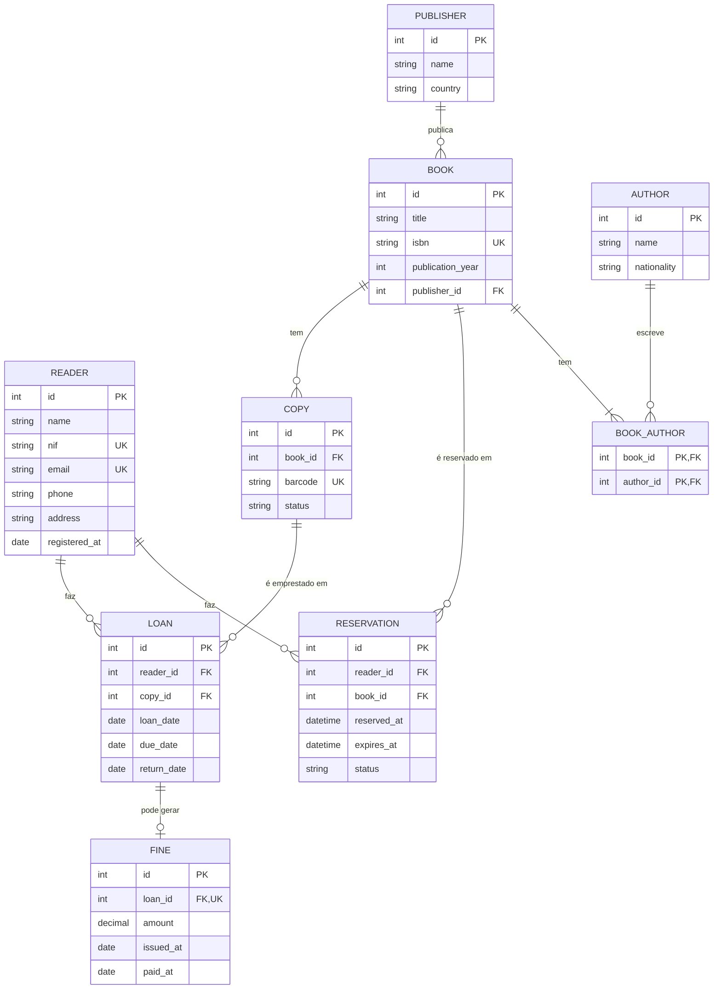

#### 1. An ER diagram in Mermaid, with cardinalities. ####

# Biblioteca municipal: diagrama ER

## Cardinalidades

| Relação | Cardinalidade | Leitura |
|---|---|---|
| Reader — Loan | 1 : N | Um leitor faz zero ou mais empréstimos; cada empréstimo é de um só leitor |
| Reader — Reservation | 1 : N | Um leitor faz zero ou mais reservas; cada reserva é de um só leitor |
| Book — Copy | 1 : N | Um livro tem zero ou mais exemplares; cada exemplar é de um só livro |
| Copy — Loan | 1 : N | Um exemplar pode ser emprestado várias vezes ao longo do tempo; cada empréstimo é de um só exemplar |
| Book — Reservation | 1 : N | Um livro pode ter várias reservas; cada reserva é de um só livro |
| Publisher — Book | 1 : N | Uma editora publica zero ou mais livros; cada livro tem uma só editora |
| Book — Author | N : M | Um livro tem um ou mais autores e um autor escreve zero ou mais livros (tabela de ligação `BOOK_AUTHOR`) |
| Loan — Fine | 1 : 0..1 | Um empréstimo gera no máximo uma multa; cada multa pertence a um só empréstimo |

## Pressupostos

- A **reserva é feita a um livro** (título) e não a um exemplar concreto, porque o leitor quer "um exemplar disponível" e não um específico.
- O **empréstimo é de um exemplar** (`COPY`), que é o objeto físico, e não do livro.
- A **multa liga-se ao empréstimo** (atraso na devolução), e o leitor obtém-se através dele.
- `loan_id` em `FINE` é `UK` para garantir uma só multa por empréstimo.